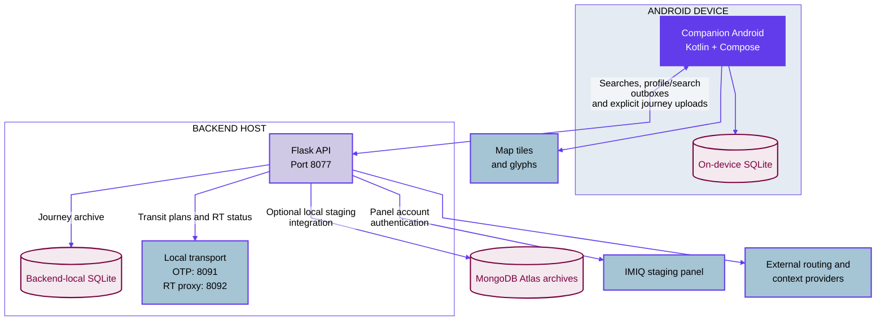
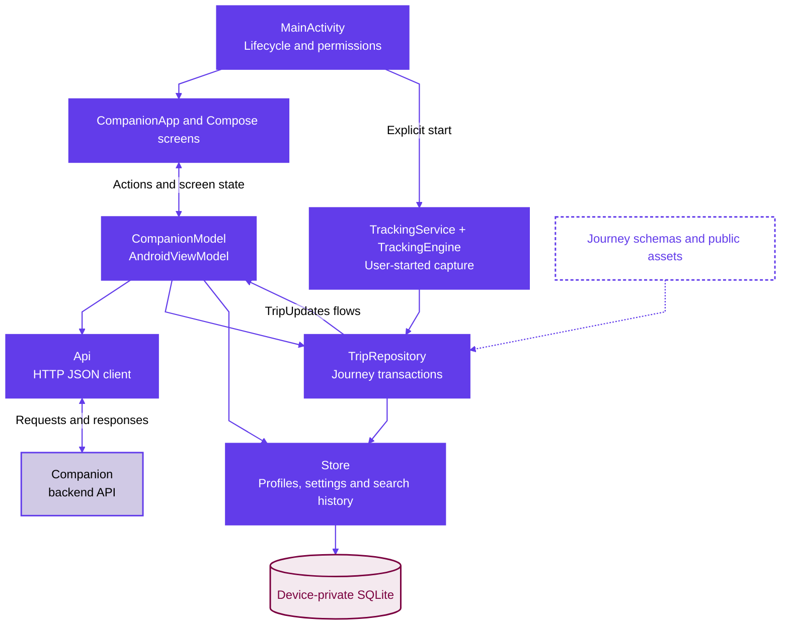
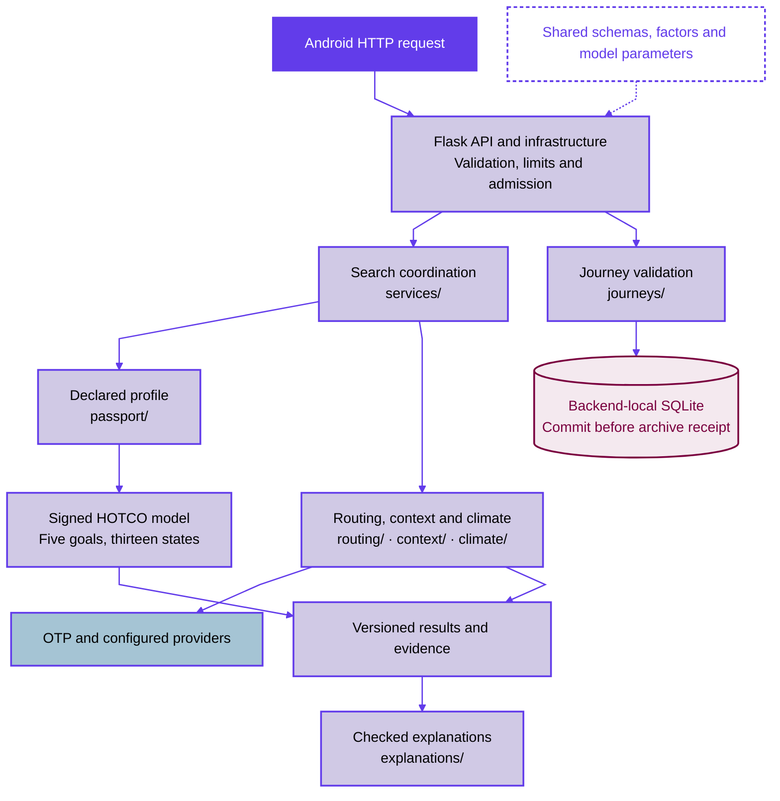
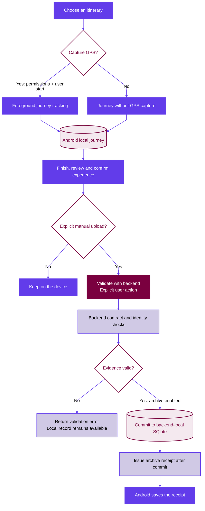
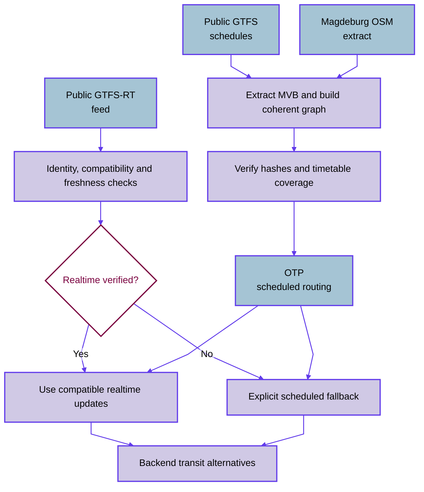
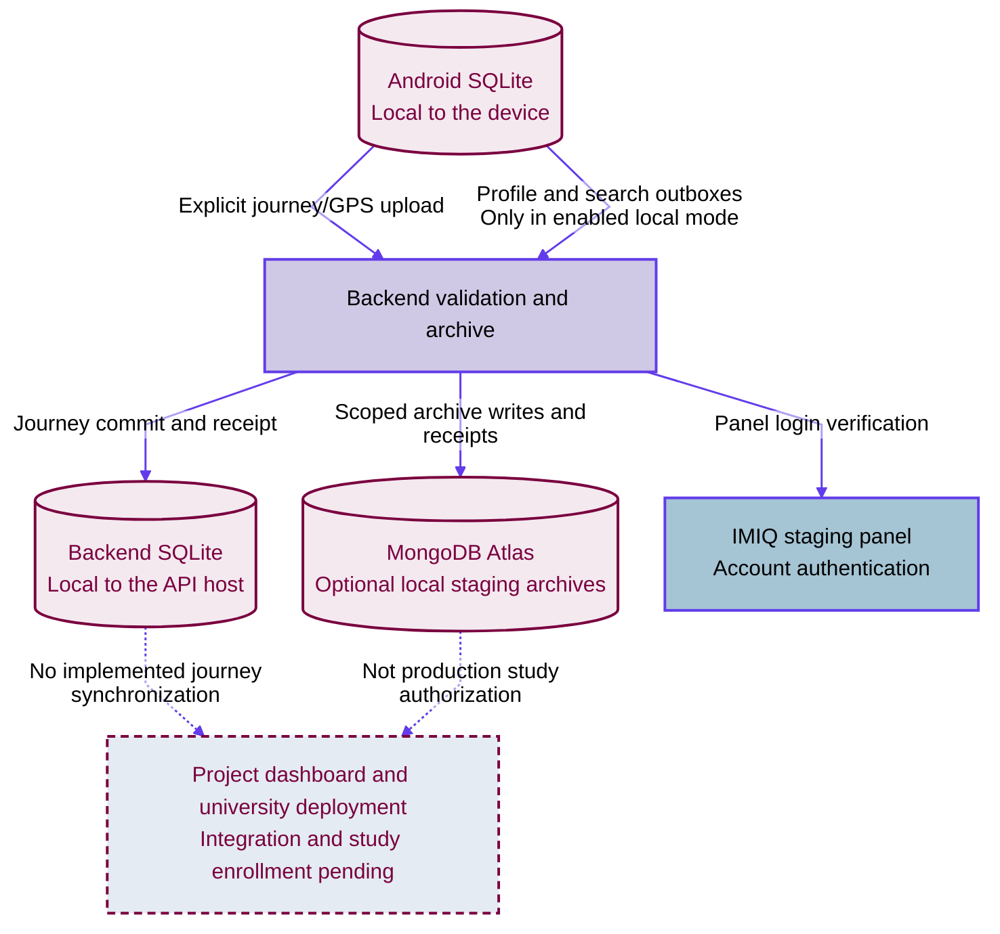

<p align="left">
  
</p>

# Companion

> **Model documentation:** [HOTCO MODEL](app-backend/model/README.md) — equations, inputs, numerical integration and reproducible synthetic figures.

**Understand your travel options. Choose a journey. Reflect on the experience.**

Companion is the native Android mobility companion of the **IMIQ — Intelligent
Mobility Space in the Quarter** project. It connects a personal travel interface
with a Python backend, a versioned five-goal model, and public mobility services
for Magdeburg.

This guide explains **what the app does, how its components work together, where
data is stored, and how colleagues can build and run it**.

| Application | Frontend | Backend | Local transport |
| --- | --- | --- | --- |
| **0.4.157 · code 168** | Kotlin · Jetpack Compose | Python · Flask | OpenTripPlanner 2.7.0 · MVB GTFS |
| `de.ovgu.imiq.companion` | Android 8.0+ · target API 36 | `/api/companion` | API **8077** · OTP **8091** · RT **8092** |

**Read first:** SQLite remains the **local** data-management mechanism on Android
and the backend host. The current version also supports optional, owner-authorized
**panel login and optional MongoDB Atlas archives in local USB/staging mode**. Dashboard
integration, university deployment and production study enrollment remain in
progress. The app does not automatically upload GPS when a journey ends.

The [USB testing release](https://github.com/imiq-project/companion/releases/tag/v0.4.157-usb)
provides the APK, checksums and build information. It connects to a backend running
on your computer through USB; publishing this repository does not deploy a server.

## Contents

- [Service overview](#service-overview)
- [System architecture](#system-architecture)
- [Android frontend](#android-frontend)
- [Python backend](#python-backend)
- [Journey lifecycle](#journey-lifecycle)
- [Public transport flow](#public-transport-flow)
- [Data management and project integration](#data-management-and-project-integration)
- [Repository map](#repository-map)
- [Getting started](#getting-started)
- [Configuration and operations](#configuration-and-operations)
- [Troubleshooting](#troubleshooting)
- [Public data and third-party notices](#public-data-and-third-party-notices)

---

## Service overview

Companion supports a complete local journey workflow: establish personal
priorities, compare travel alternatives, choose a route, record or review a
journey, and report the experience.

| Capability | What colleagues should know |
| --- | --- |
| Personal priorities | Five goals: **environmental impact, physical activity, cost, speed and comfort**. |
| Travel comparison | Walking, cycling, public transport and car alternatives depend on the configured providers and declared availability. |
| Context and maps | Native MapLibre map, explicit point confirmation, stops, departures and estimated CO₂ impact; weather remains archived as context rather than a comparison banner. |
| Journey capture | A user-started Android foreground service can capture permitted location fixes; journeys without GPS are also supported. |
| Review and history | Search results, route choices, journeys and experience reports are held in local Android storage. |
| Validation and archive | **Data and validation → Validate with backend** explicitly sends a search and journey for backend validation and optional local archiving. |
| Visual companion | Imdillo introduces profile creation; the profile uses sliders, and the final beliefs action confirms the Passport without a separate review page. |

### Current implementation and work in progress

| Area | Status in this version |
| --- | --- |
| Android app, Flask API and local transport tools | Implemented; connected functionality depends on provider and service availability. |
| SQLite on Android and on the backend host | Current local persistence. These are two separate databases. |
| Panel login and optional Atlas archives | Panel login is enabled in the local example; Atlas archives require separate private setup and explicit opt-in. |
| Data management in the project dashboard and project servers | **Integration in progress**; local Atlas receipts do not establish university deployment or production study enrollment. |
| Automatic GPS synchronization at journey completion | Not implemented; the validation/upload action is manual. |
| Operational learning | **Disabled.** Experimental and shadow components do not enable production learning. |

The numerical model retains **five goals and thirteen states**. Parameters,
equations, factors and evidence contracts are versioned. Historical eleven-goal
material is not used as current profile input.

## System architecture

### Reading the diagrams

The diagrams use the official IMIQ palette: **Majorelle purple, Pale Blue and
OVGU Burgundy**, together with their light variants. Each component keeps the
same color throughout this guide. The visual legend below shows the colors;
the table explains their meaning.


| Component | Visual appearance | Meaning |
| --- | --- | --- |
| Android | Purple | App interface, state and device-side logic. |
| Backend | Light purple | Flask handlers and application services. |
| Provider | Pale blue | External services and separate transport processes. |
| Storage | Light pink cylinder with a burgundy outline | Local SQLite database or separately configured Atlas archive. |
| Shared contract | White box with a dashed purple outline | Shared schema or versioned resource. |
| User action | Burgundy box | An explicit action taken by the user. |
| Decision | White diamond with a burgundy outline | A condition checked by the application. |
| Integration in progress | Light blue box with a dashed burgundy outline | Integration that is not yet operational. |

Arrows show the named interaction or dependency. A dashed **schema** connection
means a shared resource dependency; a dashed **in-progress** connection describes
work that is not yet operational. Labels and shapes carry meaning as well as color.

### Components and process boundaries



Android, Flask, OTP and the RT proxy are separate runtime components. The
transport box in the overview groups two separate processes; the transport flow
below explains their schedule/realtime boundary. The
`contracts/` directory is shared source material, not another service. The two
SQLite databases belong to different hosts. Optional Atlas archives are a
separate, explicitly configured path, described below; neither local database
establishes dashboard integration or production university deployment.

## Android frontend

The frontend is a native **Kotlin/Jetpack Compose** app. `MainActivity` connects
Android lifecycle events, permissions, imports/exports and tracking actions to
the UI. `CompanionModel` holds screen state and coordinates the app's operations.

In **0.4.157**, Travel uses a compact two-row search bar without the shared brand
header. A map tap creates a provisional A/B point: only **Use as origin/destination**
changes the search; Cancel/Back leave it unchanged. Reverse-geocoded addresses
are presented as nearby labels and never move the selected coordinates. **Map
layers** groups styles and mobility overlays; **My location** is separate. The
camera and controls account for the measured search bar and bottom panel.

**Settings** groups **Personalization** (Weekly goals, CO₂ emission profile and
Available transport), Journey history, My data and About Companion. History shows
the recommendation and **Open journey**. My data offers only local history clearing
and local reset; neither deletes uploaded server records. Sign out sits beside
Create new Passport. Weekly priorities remain distinct from per-search EMA;
these interface updates do not alter HOTCO equations or enable learning.



### Where to look in the frontend

All Kotlin modules below live in
[`frontend/app/src/main/java/de/ovgu/imiq/companion/`](frontend/app/src/main/java/de/ovgu/imiq/companion/).

| Responsibility | Main entry points |
| --- | --- |
| Activity and UI entry | `MainActivity.kt`, `CompanionApp.kt`, `CompanionModel.kt`. |
| Profile and priorities | `WeeklyPrioritiesUi.kt`, `ProfileConnectionsUi.kt`, `GoalPersonalizationUi.kt`, `GoalPriorities.kt`, `SituatedImportance.kt`. |
| Search and alternatives | `JourneyUi.kt`, `TravelPlanningUi.kt`, `PlanningPointUi.kt`, `RouteData.kt`, `RouteSummaryData.kt`, `RouteSummaryUi.kt`. |
| Maps and mobility context | `NativeMap.kt`, `VectorMapUi.kt`, `PlanningMapLayersUi.kt`, `MapPlacesUi.kt`, `DepartureBoardData.kt`, `ClimateData.kt`. |
| Local persistence and HTTP | `Data.kt`: `Store`, SQLite helpers and `Api`. |
| Tracking and journey integrity | `TrackingService.kt`, `TrackingEngine.kt`, `TripRepository.kt`, `JourneyContract.kt`, `TrackingLocationQuality.kt`. |
| Settings, history and experience | `SettingsMenuUi.kt`, `ExperienceUi.kt`, `CompactExperienceUi.kt`, `JourneyContextCapture.kt`. |
| Visual companion and assets | `CompanionUi.kt`, companion/scene UI modules, `assets/art/`, `assets/branding/` and `res/`. |

The app uses the local SQLite tables **`kv`** and **`searches`**. Search documents
include choices and nested journeys. Recording a journey changes local state;
it does not by itself create an archived journey on the backend.

**Shared assets:** Gradle also packages the sibling `contracts/` directory.
Android's asset packaging expands `.json.gz` catalogue sources into `.json`
assets. Keep `frontend/` and `contracts/` in their repository-relative locations.

## Python backend

[`application.py`](app-backend/application.py) creates the Flask app and registers
the API modules. Infrastructure code handles request limits, authentication when
configured, response transport and service settings. Domain modules validate and
process their own inputs.



### Backend module map

| Folder | Responsibility |
| --- | --- |
| [`infrastructure/`](app-backend/infrastructure/) | Environment/settings validation, HTTP safeguards, concurrency, compression and identifier compatibility. |
| [`services/`](app-backend/services/) | Coordinates profile/model calls and route searches across domain modules. |
| [`passport/`](app-backend/passport/) | Declared priorities, versioned Passports and optional authenticated profile/EMA/search/results/HOTCO transfers to Atlas. |
| [`model/`](app-backend/model/) | Signed HOTCO dynamics, input mapping, readout, diagnostics and robustness. |
| [`routing/`](app-backend/routing/) | Route providers, OTP integration, geometry, stops, departures, parking, geocoding and map APIs. |
| [`context/`](app-backend/context/) | Weather and environmental observations with provider provenance. |
| [`climate/`](app-backend/climate/) | Factor-based climate estimates and vehicle profile handling. |
| [`journeys/`](app-backend/journeys/) | Journey/evidence contracts, validation, identity checks and local SQLite archiving. |
| [`explanations/`](app-backend/explanations/) | Saved evidence projection, reviewed wording, reflection and optional narration. |
| [`comfort_pilot/`](app-backend/comfort_pilot/) | Versioned longitudinal/experimental APIs and shadow components; operational learning remains disabled. |
| [`artifacts/`](app-backend/artifacts/) | Small public model metadata; not participant records or generated reports. |

Context is archived as **observations** under the current public policy. It does
not add external forcing to HOTCO dynamics. Climate estimates and explanatory
wording do not change the model's equations or gains. Explanations use saved
evidence; optional narration is not a substitute for the numerical result.

### Key HTTP boundaries

| Endpoint | Purpose |
| --- | --- |
| `GET /health/live` | API process liveness. |
| `GET /health` and `GET /health/ready` | Model/service metadata and readiness information; evaluate the reported status as well as HTTP success. |
| `POST /api/companion/auth/panel/login` | Panel account login when enabled; private credentials are not bundled. |
| `POST /api/companion/goal-personalization/prepare` | Prepare the declared goal/priorities profile. |
| `/api/companion/data/...` | Optional, separately enabled loopback/staging archive APIs for profiles, EMA, search metadata/results and HOTCO evidence. |
| `POST /api/companion/routed-contextual-deliberation` | Compute a route comparison with versioned model results and context evidence. |
| `GET /api/companion/journeys/contract` | Obtain the journey contract. |
| `POST /api/companion/journeys/validate` | Validate explicitly submitted evidence and archive it if storage is enabled. |
| `/api/companion/longitudinal/...` | Versioned evidence and experimental endpoints; endpoint availability does not enable production learning. |

This is an orientation map, not the full API specification. The registered
handlers and [`contracts/`](contracts/) define the actual payloads and checks.

## Journey lifecycle

1. **Declare and search:** the user supplies priorities, availability, origin,
   destination and departure information; the backend returns alternatives.
2. **Choose and capture:** the chosen itinerary is saved locally. A user can
   start GPS tracking with permissions, or use a journey flow without GPS.
3. **Review:** the user finishes/reviews the journey and confirms the experience;
   Android keeps the search, journey and related evidence locally.
4. **Validate/upload explicitly:** only the manual validation action submits the
   search and journey to the backend archive endpoint.

Separately, in the enabled local panel/Atlas mode, confirmed profile versions and
supported EMA/search/results/HOTCO archives use their existing automatic outboxes
and receipts. Searches can be archived without a performed journey. This does
not turn the manual journey/GPS submission above into automatic synchronization.



The archive path above assumes `COMPANION_JOURNEY_STORAGE_ENABLED=1`. When
storage is disabled, valid evidence can receive a validation-only response with
`stored_on_server=false`; it is not an archive receipt. With archiving enabled,
receipts follow a committed write, retries are idempotent and revisions are
immutable.

**Capture, validation, persistence and synchronization are separate operations.**
GPS points alone do not establish movement, and a planned route is not proof of
an observed journey. Finishing a journey does not automatically synchronize GPS
to the backend or to the project dashboard.

## Public transport flow

The local transport setup covers **MVB** services in Magdeburg. It combines an
identity-preserving GTFS subset with an OSM street graph and a separate realtime
identity proxy.



Scheduled routing readiness is checked independently of realtime. Invalid or
unverifiable RT is not made available by relaxing trip/stop identities. An RT
failure can use the explicit scheduled fallback; an invalid or missing static
timetable is a different failure that must be resolved independently.

## Data management and project integration

### What is stored today

| Store | Location and owner | Contents and meaning |
| --- | --- | --- |
| Android SQLite | App-private device storage, `companion-native-v1.db`. | Local profiles/settings, searches, nested journeys, experience evidence and receipts. |
| Backend SQLite | Local to the API host; default `runtime/state/user-data/journeys.sqlite3`, or `COMPANION_JOURNEY_DB`. | Explicitly received and validated search/journey archive, identities and immutable revisions. |
| Optional MongoDB Atlas | Configured privately on the backend host; loopback/staging mode. | Scoped participant identity, confirmed profile versions, weekly/EMA observations, search metadata/results and archived HOTCO evidence; linked by participant/search/profile identifiers and receipts. |
| Public transport state | `runtime/state/transit-*`, or `COMPANION_STATE_DIR`. | Public infrastructure inputs, release pointers, graph manifests and synchronization status; separate from participant data. |

### Integration status



**The dashed university/dashboard integration above is not operational in this
release.** A journey receipt confirms a commit to the backend host's local SQLite
archive. An Atlas transfer receipt confirms its separately scoped archive write.
Neither establishes that a journey is available in the project dashboard, that
GPS is centrally synchronized, or that study membership/consent is verified.

Panel/Atlas integration remains restricted to owner-authorized local staging
tests (`app_imiq_test`). It is disabled by default in the example configuration;
enabling it requires your own authorized panel account and private Atlas setup.
The runtime adapter `infrastructure/panel_atlas_test.py` is required by login and
archive routes despite its historical name; it is not an automated test suite.

Keep participant answers, coordinates, journeys, SQLite files, phone exports,
credentials, signing keys, logs and backups out of Git and public packages.
Generated public transport resources are also excluded from the source repository.

### Shared contracts

| Resource | Role |
| --- | --- |
| `companion-identity-v1.json` | Product identifiers and exact hashes of current contracts. |
| `hotco-signed-model-v1.json` | Five-goal, thirteen-state numerical model parameters. |
| `journey-v1.schema.json` | Journey and confirmed-experience contract. |
| `questionnaire-profile-v1.schema.json`, `priorities-observation-v1.schema.json` | Versioned profile/questionnaire and weekly/EMA transfer contracts. |
| `search-metadata-v1.schema.json`, `search-results-v1.schema.json`, `hotco-transfer-v1.schema.json` | Separate search, routing-results and HOTCO archive contracts. |
| `longitudinal-*.json` | Versioned evidence and experimental schemas/namespace metadata. |
| `climate-factors-v1.json` and `vehicle-*.json.gz` | Public climate factors and vehicle catalogue/reference data. |
| `magdeburg-*.json` | Public mobility locations and tram reference alignments. |

Version identifiers and content hashes link frontend and backend evidence. Keep
numerical parameters and contract identities synchronized; do not edit saved
evidence or history to make a validation succeed.

## Repository map

Use the module tables above for responsibilities and this tree for navigation.
The tree describes the published application source, including representative
files; generated runtime data is shown separately.

<details>
<summary><strong>Expand the application source tree</strong></summary>

```text
.
├── companion.py                         # Operational CLI
├── frontend/                            # Android Gradle project
│   ├── app/
│   │   ├── build.gradle.kts
│   │   └── src/
│   │       ├── main/
│   │       │   ├── AndroidManifest.xml
│   │       │   ├── java/de/ovgu/imiq/companion/
│   │       │   │   ├── MainActivity.kt
│   │       │   │   ├── CompanionApp.kt / CompanionModel.kt
│   │       │   │   ├── Data.kt / TripRepository.kt
│   │       │   │   ├── TrackingService.kt / TrackingEngine.kt
│   │       │   │   └── Other UI, map, profile, journey and contract modules
│   │       │   ├── assets/
│   │       │   │   ├── art/jrpg/         # Companion and scene sprite resources
│   │       │   │   ├── branding/         # Product graphics
│   │       │   │   ├── maps/             # Map styles and their notices
│   │       │   │   └── licenses/
│   │       │   └── res/
│   │       │       ├── drawable/ / drawable-nodpi/
│   │       │       ├── mipmap-anydpi-v26/ / mipmap-anydpi-v33/
│   │       │       └── values/ / xml/
│   │       └── debug/res/xml/            # Development network policy
│   ├── gradle/wrapper/                   # Gradle bootstrap JAR and properties
│   ├── build.gradle.kts / settings.gradle.kts
│   └── gradle.properties / gradlew / gradlew.bat
├── app-backend/
│   ├── application.py                    # Flask application factory
│   ├── api_routes.py                     # Shared API registration
│   ├── main.py                           # Local HTTP entry point
│   ├── resources.py / requirements.txt
│   ├── model/                            # Numerical model and readout
│   ├── passport/                         # Declared priorities and profile logic
│   ├── services/                         # Search and model coordination
│   ├── routing/                          # Routing, stops, departures and map APIs
│   ├── context/                          # Weather and environmental context
│   ├── climate/                          # Climate estimates and vehicle profiles
│   ├── journeys/                         # Evidence validation and SQLite archive
│   ├── explanations/                     # Checked evidence and narration
│   ├── infrastructure/                   # Settings, limits, HTTP and compatibility
│   ├── comfort_pilot/                    # Versioned experimental components
│   ├── artifacts/                        # Public five-goal model metadata
│   └── choice_wording_v1.json            # Versioned presentation wording
├── contracts/
│   ├── companion-identity-v1.json        # Product identifiers and contract hashes
│   ├── hotco-signed-model-v1.json        # Numerical model parameters
│   ├── journey-v1.schema.json
│   ├── longitudinal-*.json               # Evidence and experimental schemas
│   ├── climate-factors-v1.json
│   ├── vehicle-*.json.gz                 # Public catalogues, not user profiles
│   └── magdeburg-*.json                  # Public mobility reference data
├── operations/
│   ├── runtime.py                        # Service ownership and release lifecycle
│   ├── transit.py                        # Bootstrap, GTFS updates and activation
│   ├── checks.py                         # Operational diagnostics
│   └── transit_runtime/
│       ├── gtfs_subset.py                # Identity-preserving MVB extraction
│       └── rt_proxy.py                   # Realtime filtering and compatibility
├── deploy/
│   ├── local.env.example / backend.env.example / atlas.env.example
│   ├── constraints-python313.txt
│   ├── gunicorn.conf.py
│   ├── companion-*.service
│   └── companion-transit-sync.timer / companion-transit-sync.sudoers
├── .gitignore / .gitattributes
├── README.md
└── THIRD_PARTY_NOTICES.md
```

</details>

The [`master`](https://github.com/imiq-project/companion/tree/master) branch
contains the current application. The previous remote app is preserved under
`legacy/` on the separate [`legacy`](https://github.com/imiq-project/companion/tree/legacy)
branch. `legacy-pre-0.4.157` also preserves the master immediately before this
publication, including the recent HOTCO documentation changes. The published
selection excludes tests/fixtures, internal operational
history, design drafts, user data, secrets, build output and local backups.

<details>
<summary><strong>Expand generated local runtime state — excluded from Git</strong></summary>

```text
runtime/
├── otp-shaded-2.7.0.jar
└── state/
    ├── transit-active.json
    ├── transit-bootstrap/                # Public inputs for first graph creation
    ├── transit-releases/<release>/
    │   ├── graph/                        # GTFS, OSM, configs, manifest and graph
    │   ├── build-state.json / ready.json
    │   └── build.log
    ├── transit-sync.json
    ├── services/                         # Local process logs
    └── user-data/journeys.sqlite3         # Private backend-local archive
```

`COMPANION_STATE_DIR`, `COMPANION_OTP_JAR` and `COMPANION_JOURNEY_DB` can move
these resources outside the checkout. The Android database remains in the
device's app-private storage.

</details>

---

## Getting started

### Prerequisites

For Android compilation:

- Android Studio, or an Android SDK installation with platform **36**.
- A compatible Java installation for Android Gradle Plugin 8.13.0 (Java 17 or
  newer; Java 21 can also serve the backend transport tools).
- Gradle is provided through the checked-in wrapper; do not install a different
  global Gradle version to replace it.

For the backend and local public transport:

- Python **3.13** is the reference environment for the supplied constraints.
- Java **21 or newer** for OpenTripPlanner 2.7.0.
- Internet access for dependency and initial transport downloads, plus connected
  routing, weather, geocoding and map services.
- Several GB of free disk and RAM for graph building. Defaults reserve at least
  2 GiB of free disk and allow a 4 GiB graph-build Java heap; increase resources
  as needed. The default serving heap is 2 GiB.
- PowerShell 7 (`pwsh`) for the Windows process-management commands, or Linux
  with `/proc` available. Gunicorn and systemd templates target Linux.

### 1. Set up the backend environment

```sh
git clone --branch master https://github.com/imiq-project/companion.git
cd companion
python -m venv .venv
```

Activate the environment in PowerShell:

```powershell
.\.venv\Scripts\Activate.ps1
```

Or on Linux:

```sh
. .venv/bin/activate
```

Install the backend dependencies:

```sh
python -m pip install -r app-backend/requirements.txt -c deploy/constraints-python313.txt
```

Copy `deploy/local.env.example` to `app-backend/.env` for local use. This example
uses loopback binding and no API token, intended for development on your own
computer. The real `.env` is private and must remain untracked. Process environment
variables take precedence over it. Provider URLs are configuration examples;
availability and access to IMIQ services must be confirmed with their operator.

```powershell
Copy-Item deploy/local.env.example app-backend/.env
python companion.py config --json
```

On Linux use `cp deploy/local.env.example app-backend/.env`.

#### Panel login and optional Atlas archives

The current local example enables panel login against
`https://imiq-staging.et.uni-magdeburg.de`, study `app_imiq_test`. Enter your own
authorized panel credentials in Android. Atlas transfers remain disabled until
you deliberately configure them; without that setup, uploads are paused.

For the optional owner-authorized Atlas flow, install the driver:

```sh
python -m pip install -r deploy/requirements-mongodb.txt
```

Create your private `runtime/state/private/atlas.env` using
`deploy/atlas.env.example`. Supply your authorized database user, URI and database,
URL-encode any password embedded in the URI, and authorize the backend computer's
network in Atlas. Never commit the real file or put the URI in Android.

In your private `app-backend/.env`, update the following existing values rather
than adding conflicting duplicates, then restart the backend:

```dotenv
COMPANION_PANEL_ATLAS_LOCAL_TEST=1
COMPANION_PROFILE_UPLOAD_LOCAL_VALIDATION=1
COMPANION_BLOCK04_LOCAL_TEST=1
COMPANION_BLOCK05_LOCAL_TEST=1
COMPANION_BLOCK06A_LOCAL_TEST=1
COMPANION_BLOCK06B_LOCAL_TEST=1
```

Keep the separate synthetic block-03 test endpoint disabled. Do not relax the
loopback checks to expose this staging integration publicly. These settings
do not enable production study enrollment, verified consent or learning.

### 2. Initialize and start local transport

A clean checkout deliberately has no OTP JAR, graph, GTFS feed or user database.
Run the initial setup once:

```sh
python companion.py data transit bootstrap
```

This command:

1. Refuses to overwrite an existing active transit installation.
2. Downloads OTP 2.7.0 from its upstream release and verifies the pinned SHA-256.
3. Downloads the Magdeburg OSM PBF extract from BBBike over HTTPS, or accepts a
   local extract with `--osm /path/to/Magdeburg.osm.pbf`.
4. Downloads the current public German GTFS feed and extracts MVB services while
   retaining original trip, route and stop identities.
5. Builds an OTP graph, writes and verifies input hashes, checks effective
   timetable coverage, and creates the first active-release pointer.

Setup writes only to configured runtime locations. It does **not** start services
or claim that routing is available before the subsequent checks pass. A failed
setup leaves the active pointer absent; fix the reported issue and retry.
The OSM extract must cover Magdeburg. Its download is size checked and its
resulting hash is recorded with the graph inputs; unlike the OTP executable,
the moving OSM and GTFS sources are not pinned to an old snapshot.

Start and inspect the services:

```sh
python companion.py ops plan
python companion.py ops start
python companion.py check --services
python companion.py check --synthetic-route
```

Allow OTP time to load the graph before checking. The default ports are **8077**
for the API, **8091** for OTP and **8092** for the realtime proxy. Scheduled transit
readiness is checked independently of realtime availability. If realtime identity
cannot be verified, transport must use the explicit scheduled fallback; identifiers
are never relaxed to force realtime availability.

For later updates:

```sh
python companion.py data transit sync
python companion.py data transit status
python companion.py data transit verify
```

`sync` checks for a new static feed, builds a coherent replacement when needed,
and verifies scheduled routing before completing replacement activation. It can
restart the owned local transport processes. `watch` repeats synchronization;
the Linux service and timer templates support a ten-minute schedule. Installing
those templates is a separate operator action, not part of bootstrap.

Useful settings include `COMPANION_JAVA`, `COMPANION_OTP_JAR`, `COMPANION_STATE_DIR`,
`COMPANION_OTP_BUILD_HEAP`, `COMPANION_OTP_HEAP`, and
`COMPANION_TRANSIT_BUILD_TIMEOUT`. The default build timeout is 1800 seconds.

The local transport extract covers **MVB**, not a complete regional or national
rail network. Other route options depend on the configured routing providers.

### 3. Build and connect the Android app

To install without compiling, download the APK and `SHA256SUMS.txt` from the
[0.4.157 USB testing release](https://github.com/imiq-project/companion/releases/tag/v0.4.157-usb).
The APK is debug-signed for local testing; the backend still runs on your computer.
The release also includes build provenance and its exact source commit.

Open **`frontend/`** in Android Studio, let Gradle synchronize, and build the
`app` module. Keep the repository layout intact: the app also packages assets
from the sibling **`contracts/`** directory.

From `frontend/` on Windows:

```powershell
.\gradlew.bat assembleDebug
```

On Linux, from `frontend/`:

```sh
chmod +x gradlew
./gradlew assembleDebug
```

The debug APK is generated at
`frontend/app/build/outputs/apk/debug/app-debug.apk`. Compilation does not install
the APK on a phone. SDK paths belong in environment variables (`ANDROID_HOME`)
or your private `frontend/local.properties`, never in a committed machine-specific
file. Release distribution requires your own privately managed signing setup.

The default Android backend URL is `http://localhost:8077`. For an explicitly
connected development phone, enable USB debugging and accept its authorization
prompt. From the directory containing the downloaded release APK:

```sh
adb devices
adb -s YOUR_DEVICE_SERIAL install -r Companion-0.4.157-usb-debug.apk
adb -s YOUR_DEVICE_SERIAL reverse tcp:8077 tcp:8077
adb -s YOUR_DEVICE_SERIAL shell am start -n de.ovgu.imiq.companion/.MainActivity
```

Keep USB connected and repeat reverse forwarding after reconnection/reboot.
Builds signed with another debug key cannot update an existing installation;
coordinate signing or use a separate test device if local data must be kept.

For the standard Android emulator use `http://10.0.2.2:8077` in the login screen's
Connection section. The Settings menu no longer exposes backend configuration.
A remote installation needs a reachable HTTPS endpoint and an appropriate
authentication/deployment design; this release prepares local USB testing.
Debug builds permit cleartext development connections; the main network policy
restricts cleartext to the configured local hosts.

## Configuration and operations

`deploy/backend.env.example` documents the Linux deployment environment.
`deploy/gunicorn.conf.py` configures the production WSGI server, and the
`companion-*.service` files are templates whose paths, user, environment file and
permissions must be adapted to your host. Linux deployment and HTTPS termination are operator responsibilities.

Important configuration:

| Variable | Meaning |
| --- | --- |
| `PORT`, `COMPANION_BIND_HOST` | Local API port and interface. |
| `COMPANION_OTP_PORT`, `COMPANION_REALTIME_PORT` | Distinct transport process ports. |
| `COMPANION_STATE_DIR` | Generated infrastructure state and release pointers. |
| `COMPANION_JOURNEY_DB` | Private journey database path; preferably outside the source checkout. |
| `COMPANION_JOURNEY_STORAGE_ENABLED` | Enables the backend journey archive. |
| `COMPANION_ROUTING_BASE_URL` | External route-computation provider. |
| `COMPANION_GRAPHHOPPER_BASE_URL` | External geometry provider. |
| `COMPANION_ORION_BASE_URL` | External context provider where applicable. |
| `COMPANION_OTP_BASE_URL`, `COMPANION_OTP_STATUS_URL` | OTP API and realtime identity status. |
| `COMPANION_API_TOKEN` | Optional Bearer protection of `/api/`; required by the supplied Gunicorn configuration. |

Gunicorn requires a private API token of at least 32 characters. The current
Android connection settings configure a base URL and do **not** provide a Bearer
token field. A token-protected remote API therefore needs client authentication
integration before this Android version can use it directly. Do not bake server
secrets into a public APK. The shared API token is not participant authentication.
The repository does not provide a turnkey public multi-user service.

Optional model-generated narration requires separately configured provider
credentials. Never commit them. Numeric model results, availability and clinical
or behavioral interpretations must not be inferred from a narration service.

## Troubleshooting

```sh
python companion.py ops status
python companion.py check --services
python companion.py check --providers --validation
python companion.py ops restart --service backend
python companion.py ops stop
```

Diagnostics can use configured external providers. `--validation` checks HTTP
rejection behavior; it is not a development test suite. The synthetic route
check uses public coordinates and synthetic declarations and does not archive a
participant. Default output goes to the terminal; `--output` saves a chosen report.

- **No active transit release:** run `data transit bootstrap` first.
- **Graph build failed:** inspect its `build.log` under
  `runtime/state/transit-releases/`; check Java 21+, memory, disk, downloads and
  timetable dates. Retry bootstrap if no active pointer exists.
- **API works, realtime is degraded:** inspect compatibility and feed freshness;
  retain scheduled routing instead of weakening GTFS identity checks.
- **Phone cannot reach localhost:** check the app URL, USB forwarding and API
  listener. `localhost` on a phone normally refers to the phone itself.
- **401 from a remote API:** the server requires authentication; this Android
  version needs the client integration described above.
- **Another process owns a port:** lifecycle commands refuse to stop an unknown
  listener. Resolve the conflict before retrying.

Health HTTP success alone does not establish full provider or route availability.
Checks return 0 for success, 2 for degraded service, 3 for API unavailability and
4 for OTP HTTP unavailability; operational command failures return 1.

## Public data and third-party notices

See [THIRD_PARTY_NOTICES.md](THIRD_PARTY_NOTICES.md) and the license files shipped
with Android assets. OpenStreetMap attribution must remain visible. Climate
factors are estimates with explicit boundaries, and vehicle registration names
do not imply model-specific consumption measurements.

This repository does not grant a new blanket license to Companion source code,
project branding or third-party assets. Third-party licenses retain their own
terms; obtain authorization from the respective rights holders where needed.


**Project affiliation:** IMIQ, Otto von Guericke University Magdeburg. IMIQ is
funded by the European Union and the State of Saxony-Anhalt; the existing
[official funding marks](frontend/app/src/main/assets/branding/imiq-funding-official.png)
are retained in the Android assets.
