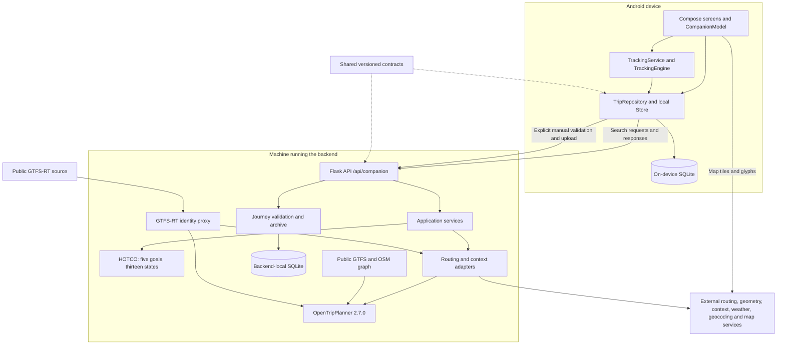

# Companion

Companion is a native Android mobility companion developed in the IMIQ project.
It helps people explore travel options in Magdeburg, consider their own priorities,
follow a journey, and reflect on their experience. This repository contains the
Android application, its Python backend, shared versioned contracts, and the
tools needed to initialize and operate local public transport services.

Current application version: **0.4.137**, Android version code **148**.
The minimum supported Android version is **Android 8.0 (API 26)**; the current
compile and target SDK are API 36.

The Android application ID and namespace are **`de.ovgu.imiq.companion`**.
Current API routes use **`/api/companion`**, configuration uses the
**`COMPANION_`** prefix, the CLI is **`companion.py`**, and Linux service names
start with **`companion-`**. This is a separate Android application identity;
installation does not replace an application registered with a different ID.
No automatic migration of existing device or server data is performed.

## What the app does

- Personalizes travel comparisons around five goals: environmental impact,
  physical activity, cost, speed and comfort.
- Shows route alternatives, maps, public transport stops and departures, and
  contextual information such as weather and estimated climate impact.
- Supports user-started journey tracking with Android location permissions,
  foreground service notifications and local journey history.
- Supports journey review and experience reporting, including journeys without
  GPS capture.
- Offers an explicit **Data and validation → Validate with backend** action to
  send a search and journey evidence to the backend for validation and storage.
- Uses a visual companion and goal displays to present travel-related feedback.

The operational model has **five goals and thirteen states**. Equations, gains,
factors and evidence formats are versioned. Experimental learning components are
present for compatibility and research, but operational learning stays disabled.
Historical eleven-goal material is not a source of current profile inputs.

## Architecture and repository layout

### Runtime components and data boundaries

The Android app and the backend are separate programs. OTP and the realtime
proxy are additional server-side processes. The shared contracts are packaged
as Android assets and read directly by Python; they are not another service.



Both SQLite stores above are **local to their respective host**. They are not a
central project database. Integration with the **project dashboard and project
servers is in progress** and is intentionally absent from the implemented
connections in this diagram. A local backend receipt does not establish dashboard
availability or central-server synchronization.

### Tracked source tree

This tree shows the published application folders and representative entry
files. It excludes build output and private runtime directories.

```text
.
├── companion.py                         # Operational CLI
├── frontend/                            # Android Gradle project
│   ├── app/
│   │   ├── build.gradle.kts
│   │   └── src/
│   │       ├── main/
│   │       │   ├── AndroidManifest.xml
│   │       │   ├── java/de/ovgu/imiq/companion/
│   │       │   │   ├── MainActivity.kt
│   │       │   │   ├── CompanionApp.kt / CompanionModel.kt
│   │       │   │   ├── Data.kt / TripRepository.kt
│   │       │   │   ├── TrackingService.kt / TrackingEngine.kt
│   │       │   │   └── Other UI, map, profile, journey and contract modules
│   │       │   ├── assets/
│   │       │   │   ├── art/jrpg/         # Companion and scene sprite resources
│   │       │   │   ├── branding/         # Product graphics
│   │       │   │   ├── maps/             # Map styles and their notices
│   │       │   │   └── licenses/
│   │       │   └── res/
│   │       │       ├── drawable/ / drawable-nodpi/
│   │       │       ├── mipmap-anydpi-v26/ / mipmap-anydpi-v33/
│   │       │       └── values/ / xml/
│   │       └── debug/res/xml/            # Development network policy
│   ├── gradle/wrapper/                   # Gradle bootstrap JAR and properties
│   ├── scripts/build.mjs                 # Optional Node build launcher
│   ├── build.gradle.kts / settings.gradle.kts
│   └── gradle.properties / gradlew / gradlew.bat
├── app-backend/
│   ├── application.py                    # Flask application factory
│   ├── api_routes.py                     # Shared API registration
│   ├── main.py                           # Local HTTP entry point
│   ├── resources.py / requirements.txt
│   ├── model/                            # Numerical model and readout
│   ├── passport/                         # Declared priorities and profile logic
│   ├── services/                         # Search and model coordination
│   ├── routing/                          # Routing, stops, departures and map APIs
│   ├── context/                          # Weather and environmental context
│   ├── climate/                          # Climate estimates and vehicle profiles
│   ├── journeys/                         # Evidence validation and SQLite archive
│   ├── explanations/                     # Checked evidence and narration
│   ├── infrastructure/                   # Settings, limits, HTTP and compatibility
│   ├── comfort_pilot/                    # Versioned experimental components
│   ├── artifacts/                        # Public five-goal model metadata
│   └── choice_wording_v1.json            # Versioned presentation wording
├── contracts/
│   ├── companion-identity-v1.json        # Product identifiers and contract hashes
│   ├── hotco-signed-model-v1.json        # Numerical model parameters
│   ├── journey-v1.schema.json
│   ├── longitudinal-*.json               # Evidence and experimental schemas
│   ├── climate-factors-v1.json
│   ├── vehicle-*.json.gz                 # Public catalogues, not user profiles
│   └── magdeburg-*.json                  # Public mobility reference data
├── operations/
│   ├── runtime.py                        # Service ownership and release lifecycle
│   ├── transit.py                        # Bootstrap, GTFS updates and activation
│   ├── checks.py / smoke.py              # Operational and synthetic diagnostics
│   └── transit_runtime/
│       ├── gtfs_subset.py                # Identity-preserving MVB extraction
│       └── rt_proxy.py                   # Realtime filtering and compatibility
├── deploy/
│   ├── local.env.example / backend.env.example
│   ├── constraints-python313.txt
│   ├── gunicorn.conf.py
│   ├── companion-*.service
│   └── companion-transit-sync.timer / companion-transit-sync.sudoers
├── .gitignore / .gitattributes
├── README.md
└── THIRD_PARTY_NOTICES.md
```

`comfort_pilot/` is part of the versioned API implementation; its presence does
not enable operational learning. `artifacts/` contains small public model metadata,
not generated reports or participant data. Android's production assets include
the sibling `contracts/` folder through its Gradle configuration, so moving the
Android project away from that folder breaks the expected build layout.

### Main application flows

1. **Profile and search:** Android stores declared priorities locally and sends
   an explicit search request to `/api/companion/routed-contextual-deliberation`.
   The backend coordinates route providers, context and the versioned numerical
   model. Returned alternatives and their evidence are saved in Android history.
2. **Journey capture:** a user-started foreground service records permitted
   location fixes into local journey state. Review and experience reporting also
   support journeys without GPS. Capturing points does not establish movement.
3. **Manual validation and archive:** the explicit validation action posts the
   chosen search and journey to `/api/companion/journeys/validate`. The backend
   validates the evidence, commits it to its local SQLite archive and then issues
   a receipt. Retries are idempotent; stored revisions are immutable.
4. **Transport maintenance:** `operations/transit.py` creates coherent releases
   from public GTFS and OSM inputs. The realtime proxy accepts only compatible
   identities; scheduled routing remains independently testable when RT fails.

### Generated state: local only

The default runtime layout is created after setup and use. It is **not tracked**:

```text
runtime/
├── otp-shaded-2.7.0.jar
└── state/
    ├── transit-active.json               # Pointer to the selected public release
    ├── transit-bootstrap/                # Public inputs for first graph creation
    ├── transit-releases/<release>/
    │   ├── graph/                        # GTFS, OSM, configs, manifest and graph.obj
    │   ├── build-state.json / ready.json
    │   └── build.log
    ├── transit-sync.json                 # Public infrastructure status
    ├── services/                         # Local process logs
    └── user-data/journeys.sqlite3         # Private backend-local journey archive
```

`COMPANION_STATE_DIR`, `COMPANION_OTP_JAR` and `COMPANION_JOURNEY_DB` can move
these resources outside the checkout. The Android database stays in the app's
private device storage; it is not this backend database. Generated transit data
and private journey data have different purposes, even when their defaults share
a `runtime/` parent folder.

The previous remote application is preserved on the separate [`legacy`
branch](https://github.com/imiq-project/app-frontend/tree/legacy), under `legacy/`.
The current `master` branch contains the selected Companion application sources.
It excludes tests, test fixtures, internal operational history, design drafts,
compiled APKs, caches, logs, user data and credentials. Local development tests
are kept separately; their absence here does not mean the app requires them.

## Requirements

For Android compilation:

- Android Studio, or an Android SDK installation with platform **36**.
- A compatible Java installation for Android Gradle Plugin 8.13.0 (Java 17 or
  newer; Java 21 can also serve the backend transport tools).
- Gradle is provided through the checked-in wrapper; do not install a different
  global Gradle version to replace it.
- Node.js is optional and needed only for the convenience scripts in
  `frontend/scripts/`. Direct Gradle commands do not require Node.

For the backend and local public transport:

- Python **3.13** is the reference environment for the supplied constraints.
- Java **21 or newer** for OpenTripPlanner 2.7.0.
- Internet access for dependency and initial transport downloads, plus connected
  routing, weather, geocoding and map services.
- Several GB of free disk and RAM for graph building. Defaults reserve at least
  2 GiB of free disk and allow a 4 GiB graph-build Java heap; increase resources
  as needed. The default serving heap is 2 GiB.
- PowerShell 7 (`pwsh`) for the Windows process-management commands, or Linux
  with `/proc` available. Gunicorn and systemd templates target Linux.

## 1. Obtain the source and configure Python

```sh
git clone --branch master https://github.com/imiq-project/app-frontend.git
cd app-frontend
python -m venv .venv
```

Activate the environment in PowerShell:

```powershell
.\.venv\Scripts\Activate.ps1
```

Or on Linux:

```sh
. .venv/bin/activate
```

Install the backend dependencies:

```sh
python -m pip install -r app-backend/requirements.txt -c deploy/constraints-python313.txt
```

Copy `deploy/local.env.example` to `app-backend/.env` for local use. This example
uses loopback binding and no API token, intended for development on your own
computer. The real `.env` is private and must remain untracked. Process environment
variables take precedence over it. Provider URLs are configuration examples;
availability and access to IMIQ services must be confirmed with their operator.

```powershell
Copy-Item deploy/local.env.example app-backend/.env
python companion.py config --json
```

On Linux use `cp deploy/local.env.example app-backend/.env`.

## 2. Initialize local public transport

A clean checkout deliberately has no OTP JAR, graph, GTFS feed or user database.
Run the initial setup once:

```sh
python companion.py data transit bootstrap
```

This command:

1. Refuses to overwrite an existing active transit installation.
2. Downloads OTP 2.7.0 from its upstream release and verifies the pinned SHA-256.
3. Downloads the Magdeburg OSM PBF extract from BBBike over HTTPS, or accepts a
   local extract with `--osm /path/to/Magdeburg.osm.pbf`.
4. Downloads the current public German GTFS feed and extracts MVB services while
   retaining original trip, route and stop identities.
5. Builds an OTP graph, writes and verifies input hashes, checks effective
   timetable coverage, and creates the first active-release pointer.

Setup writes only to configured runtime locations. It does **not** start services
or claim that routing is available before the subsequent checks pass. A failed
setup leaves the active pointer absent; fix the reported issue and retry.
The OSM extract must cover Magdeburg. Its download is size checked and its
resulting hash is recorded with the graph inputs; unlike the OTP executable,
the moving OSM and GTFS sources are not pinned to an old snapshot.

Start and inspect the services:

```sh
python companion.py ops plan
python companion.py ops start
python companion.py check --services
python companion.py check --synthetic-route
```

Allow OTP time to load the graph before checking. The default ports are **8077**
for the API, **8091** for OTP and **8092** for the realtime proxy. Scheduled transit
readiness is checked independently of realtime availability. If realtime identity
cannot be verified, transport must use the explicit scheduled fallback; identifiers
are never relaxed to force realtime availability.

For later updates:

```sh
python companion.py data transit sync
python companion.py data transit status
python companion.py data transit verify
```

`sync` checks for a new static feed, builds a coherent replacement when needed,
and verifies scheduled routing before completing replacement activation. It can
restart the owned local transport processes. `watch` repeats synchronization;
the Linux service and timer templates support a ten-minute schedule. Installing
those templates is a separate operator action, not part of bootstrap.

Useful settings include `COMPANION_JAVA`, `COMPANION_OTP_JAR`, `COMPANION_STATE_DIR`,
`COMPANION_OTP_BUILD_HEAP`, `COMPANION_OTP_HEAP`, and
`COMPANION_TRANSIT_BUILD_TIMEOUT`. The default build timeout is 1800 seconds.

The local transport extract covers **MVB**, not a complete regional or national
rail network. Other route options depend on the configured routing providers.

## 3. Build and connect the Android app

Open **`frontend/`** in Android Studio, let Gradle synchronize, and build the
`app` module. Keep the repository layout intact: the app also packages assets
from the sibling **`contracts/`** directory.

From the repository root on Windows:

```powershell
node frontend/scripts/build.mjs assembleDebug
```

Or without Node, from `frontend/`:

```powershell
.\gradlew.bat assembleDebug
```

On Linux, from `frontend/`:

```sh
chmod +x gradlew
./gradlew assembleDebug
```

The debug APK is generated at
`frontend/app/build/outputs/apk/debug/app-debug.apk`. Compilation does not install
the APK on a phone. SDK paths belong in environment variables (`ANDROID_HOME`)
or your private `frontend/local.properties`, never in a committed machine-specific
file. Release distribution requires your own privately managed signing setup.

The default Android backend URL is `http://localhost:8077`. For an explicitly
connected development phone, after installing the APK yourself, USB forwarding
can connect that address to your computer:

```sh
adb reverse tcp:8077 tcp:8077
```

For the standard Android emulator use `http://10.0.2.2:8077` in the app's
connection settings. A remote installation needs a reachable HTTPS endpoint.
Debug builds permit cleartext development connections; the main network policy
restricts cleartext to the configured local hosts.

## Configuration and deployment

`deploy/backend.env.example` documents the Linux deployment environment.
`deploy/gunicorn.conf.py` configures the production WSGI server, and the
`companion-*.service` files are templates whose paths, user, environment file and
permissions must be adapted to your host. Linux deployment and HTTPS termination are operator responsibilities.

Important configuration:

| Variable | Meaning |
| --- | --- |
| `PORT`, `COMPANION_BIND_HOST` | Local API port and interface. |
| `COMPANION_OTP_PORT`, `COMPANION_REALTIME_PORT` | Distinct transport process ports. |
| `COMPANION_STATE_DIR` | Generated infrastructure state and release pointers. |
| `COMPANION_JOURNEY_DB` | Private journey database path; preferably outside the source checkout. |
| `COMPANION_JOURNEY_STORAGE_ENABLED` | Enables the backend journey archive. |
| `COMPANION_ROUTING_BASE_URL` | External route-computation provider. |
| `COMPANION_GRAPHHOPPER_BASE_URL` | External geometry provider. |
| `COMPANION_ORION_BASE_URL` | External context provider where applicable. |
| `COMPANION_OTP_BASE_URL`, `COMPANION_OTP_STATUS_URL` | OTP API and realtime identity status. |
| `COMPANION_API_TOKEN` | Optional Bearer protection of `/api/`; required by the supplied Gunicorn configuration. |

Gunicorn requires a private API token of at least 32 characters. The current
Android connection settings configure a base URL and do **not** provide a Bearer
token field. A token-protected remote API therefore needs client authentication
integration before this Android version can use it directly. Do not bake server
secrets into a public APK. The shared API token is not participant authentication.
The repository does not provide a turnkey public multi-user service.

Optional model-generated narration requires separately configured provider
credentials. Never commit them. Numeric model results, availability and clinical
or behavioral interpretations must not be inferred from a narration service.

## Journey data and privacy

Tracking and storage are separate operations. Android records user-started
journeys locally; the explicit validation action sends evidence to the backend.
Finishing a journey does **not** automatically synchronize GPS to the server.

**SQLite is the current local data-management mechanism.** The Android app uses
an on-device SQLite database. The backend uses a separate SQLite database local
to the machine running the API; this does not mean that a journey has reached
the project's central infrastructure.

**Integration of data management into the project dashboard and project servers
is in progress.** That integration is not yet available as a complete operational
flow in this version. A successful receipt confirms a commit to the backend's
local archive, not availability in the project dashboard or synchronization with
project servers.

The backend validates incoming journey evidence and commits valid records to
its local SQLite archive. Successful archive receipts are issued after commit, retries are
idempotent, and revisions are immutable. The default private location is
`runtime/state/user-data/journeys.sqlite3`; configure `COMPANION_JOURNEY_DB` to
separate production data from the application tree.

Never commit or publish participant responses, journeys, coordinates, database
files, phone exports, API keys, signing keys, logs or backups. Public GTFS/OSM
infrastructure data is distinct from participant data; generated transport
artifacts are also excluded from this source repository.

GPS points do not by themselves establish that a person travelled, and a planned
route is not proof of an observed journey. Validation, server storage, device
capture and automatic synchronization are different claims.

## Diagnostics and troubleshooting

```sh
python companion.py ops status
python companion.py check --services
python companion.py check --providers --validation
python companion.py ops restart --service backend
python companion.py ops stop
```

Diagnostics can use configured external providers. `--validation` checks HTTP
rejection behavior; it is not a development test suite. The synthetic route
check uses public coordinates and synthetic declarations and does not archive a
participant. Default output goes to the terminal; `--output` saves a chosen report.

- **No active transit release:** run `data transit bootstrap` first.
- **Graph build failed:** inspect its `build.log` under
  `runtime/state/transit-releases/`; check Java 21+, memory, disk, downloads and
  timetable dates. Retry bootstrap if no active pointer exists.
- **API works, realtime is degraded:** inspect compatibility and feed freshness;
  retain scheduled routing instead of weakening GTFS identity checks.
- **Phone cannot reach localhost:** check the app URL, USB forwarding and API
  listener. `localhost` on a phone normally refers to the phone itself.
- **401 from a remote API:** the server requires authentication; this Android
  version needs the client integration described above.
- **Another process owns a port:** lifecycle commands refuse to stop an unknown
  listener. Resolve the conflict before retrying.

Health HTTP success alone does not establish full provider or route availability.
Checks return 0 for success, 2 for degraded service, 3 for API unavailability and
4 for OTP HTTP unavailability; operational command failures return 1.

## Public data and third-party notices

See [THIRD_PARTY_NOTICES.md](THIRD_PARTY_NOTICES.md) and the license files shipped
with Android assets. OpenStreetMap attribution must remain visible. Climate
factors are estimates with explicit boundaries, and vehicle registration names
do not imply model-specific consumption measurements.

This repository does not grant a new blanket license to Companion source code,
project branding or third-party assets. Third-party licenses retain their own
terms; obtain authorization from the respective rights holders where needed.
