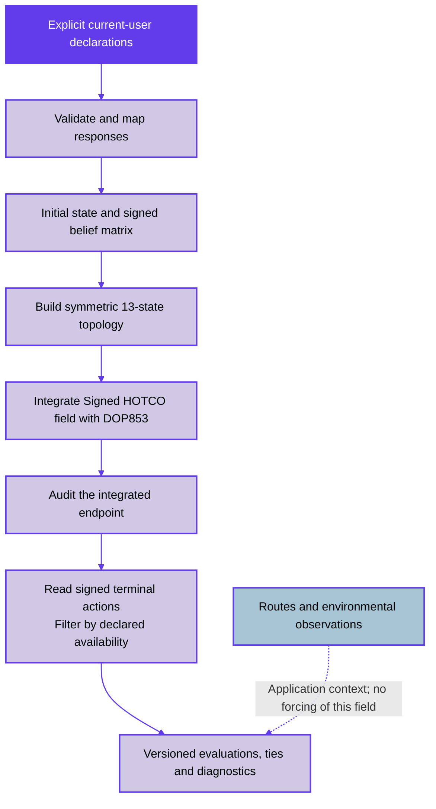
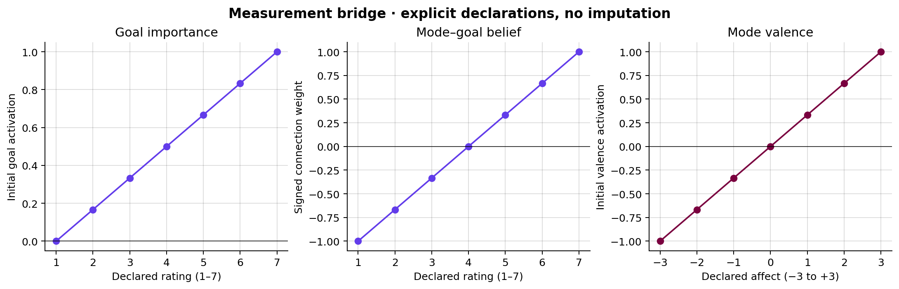
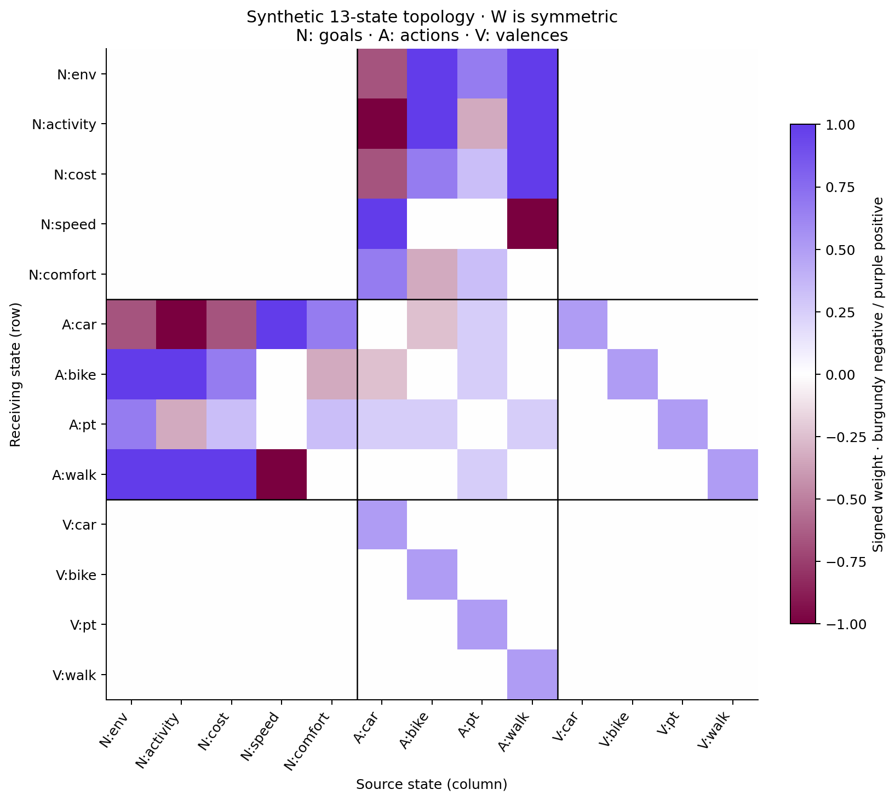
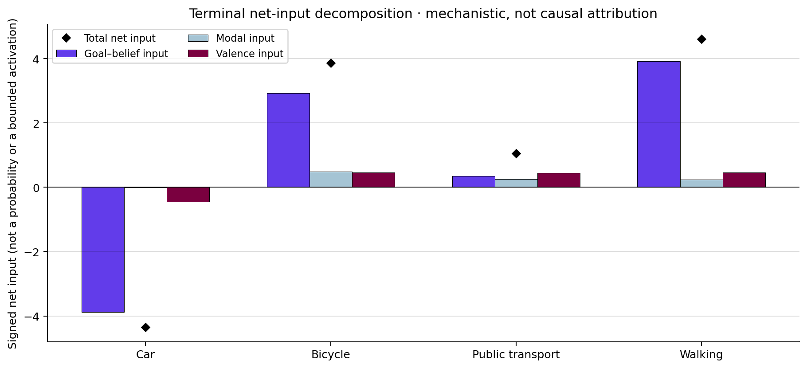
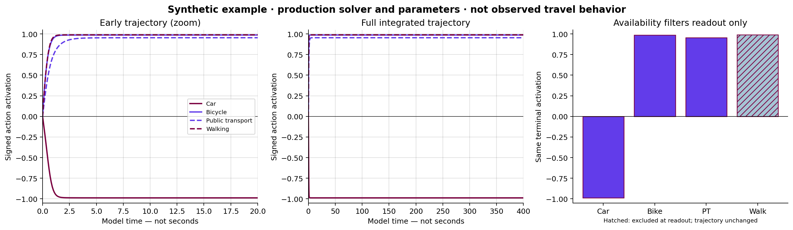

<p>
  
</p>

# Companion model

**From explicit declarations to a reproducible signed evaluation of travel modes.**

[Back to the application guide](../../README.md) · [Model contract](../../contracts/hotco-signed-model-v1.json) · [Synthetic example](examples/synthetic-input.json) · [Computed results](examples/example-results.json)

This README documents the **implemented** Signed HOTCO–Grossberg model used by
Companion. It explains the input bridge, thirteen-state network, differential
equation, numerical integration and terminal readout. It is an implementation
guide, not a claim of behavioral calibration or validation against participants.

| Identity | Current value |
| --- | --- |
| Model | `hotco_signed_grossberg_5goals_v1` |
| Input contract | `hotco_ct_input_5goals_1.0` |
| Readout | `signed-actions-v1` |
| State | **5 goal activations + 4 action activations + 4 valence activations** |
| Integration | SciPy DOP853; integrated endpoint retained |
| Learning and carryover | **No operational learning; no state carryover between simulations** |

> **Reading the examples:** every input and figure below is synthetic. Model time
> is not elapsed journey time or human reaction time. Activations are signed
> model quantities, not probabilities, observed preferences or measured emotions.

## Contents

- [Role in Companion](#role-in-companion)
- [Inputs and measurement bridge](#inputs-and-measurement-bridge)
- [The thirteen-state network](#the-thirteen-state-network)
- [State equation](#state-equation)
- [Numerical integration and diagnostics](#numerical-integration-and-diagnostics)
- [Reading the output](#reading-the-output)
- [Synthetic worked example](#synthetic-worked-example)
- [Reproduce the figures](#reproduce-the-figures)
- [Code map and interpretation limits](#code-map-and-interpretation-limits)

## Role in Companion

The numerical package consumes a validated profile and produces trajectories,
topology, an integrated terminal state and numerical diagnostics. Backend services
coordinate that calculation with routes and observations. Android presents the
result and saves its associated evidence.



The current public context policy is **`observations_only`**. Weather, geometry
and context are not extra forcing terms in this field. Climate estimates and
generated narration do not refit its weights or change its equations.

## Inputs and measurement bridge

The canonical input order is fixed:

| Axis | Canonical order |
| --- | --- |
| Five goals | `pro_env`, `physical`, `cost`, `speed`, `comfort` |
| Four modes | `car`, `bike`, `pt`, `walk` |
| Belief matrix | Four mode rows × five goal columns: **20 explicit responses** |

The direct questionnaire parser requires complete, valid declarations. It does
not fill missing answers with averages, neutral values or inferred usage habits.
Mode-use frequency is not an input to the state equation.

For raw goal importance $r_i$, belief $b_{mi}$ and mode valence $e_m$:

$$
n_i(0)=\frac{r_i-1}{6},\qquad
R_{mi}=\frac{b_{mi}-4}{3},\qquad
v_m(0)=\frac{e_m}{3},\qquad a_m(0)=0.
$$

| Declaration | Raw scale | Numerical role |
| --- | --- | --- |
| Goal importance | Integer 1–7 | Initial goal activation in $[0,1]$. |
| Mode–goal belief | Integer 1–7 | Signed edge in $[-1,1]$; 4 maps to zero. |
| Mode valence | Integer −3 to +3 | Initial valence activation in $[-1,1]$. |
| Availability | Explicit Boolean per mode | Filters terminal readout; at least one mode must be available. |



**Figure 1. Measurement bridge.** These are deterministic transformations, not
estimated coefficients. Independent importance ratings are not normalized to
sum to one. The backend's profile preparation belongs to `passport/`; this
example enters through the direct questionnaire parser.

## The thirteen-state network

The state vector contains three blocks:

$$
x=(n_1,\ldots,n_5,\;a_{car},a_{bike},a_{pt},a_{walk},\;
v_{car},v_{bike},v_{pt},v_{walk})^T.
$$

| Python indices | Block | Interpretation inside the simulation |
| --- | --- | --- |
| `0:5` | $n$ | Goal activations, initialized from declared importance. |
| `5:9` | $a$ | Action activations, initialized at zero. |
| `9:13` | $v$ | Valence activations, initialized from declared affect. |

**All thirteen states evolve.** Goals and valences are not clamped to their
initial values. A simulated goal or valence activation must not be relabeled as
a new questionnaire response or an observed change in the participant.

The topology is symmetric, with receiving nodes in rows and source nodes in
columns:

$$
W=\begin{pmatrix}
0_{5\times5} & R^T & 0_{5\times4}\\
R & cM & \kappa I_4\\
0_{4\times5} & \kappa I_4 & 0_{4\times4}
\end{pmatrix},\qquad c=0.25,\quad\kappa=0.5.
$$

Here the production belief-strength multiplier is 1. **Beliefs are not divided
by the number of goals.** The fixed modal pattern uses the order
`car, bike, pt, walk`:

$$
M=\begin{pmatrix}
0&-1&1&0\\
-1&0&1&0\\
1&1&0&1\\
0&0&1&0
\end{pmatrix}.
$$



**Figure 2. Synthetic topology.** Purple means a positive signed weight,
burgundy a negative weight, and white zero. The heatmap uses the IMIQ palette;
its color scale encodes weight sign, rather than the software-component roles
used in the application architecture diagrams. This is a model network, not a
transport map or an empirically estimated causal graph.

## State equation

The net input is formed **before** positive/negative rectification:

$$
u=Wx,\qquad
\tau\dot{x}_i=u_i-dx_i-x_i|u_i|,
\qquad d=0.05,\quad\tau=0.8.
$$

Equivalently, with $u_i^+=\max(u_i,0)$ and $u_i^-=\max(-u_i,0)$:

$$
\tau\dot{x}_i=-dx_i+(1-x_i)u_i^+-(1+x_i)u_i^-.
$$

The code does not rectify individual incoming edges before summing them. It
does not apply a softmax, normalize action scores, or clip integrated states.
The signed state bounds are $[-1,1]$; a numerical bound violation above the
implementation's tolerance raises an error. The net inputs themselves need not
lie in that interval.

For one action coordinate, the net input has three additive channels:

$$
u_{a_m}=\underbrace{\sum_iR_{mi}n_i}_{\text{goal–belief input}}
+\underbrace{c\sum_qM_{mq}a_q}_{\text{modal input}}
+\underbrace{\kappa v_m}_{\text{valence input}}.
$$



**Figure 3. Terminal input channels.** The three bars sum to the black net-input
marker. These values explain the implemented mechanism at that state. They are
not causal shares, percentages of a real-world decision or measurements of how
the user felt.

## Numerical integration and diagnostics

The authoritative defaults are in [`SignedHOTCOParameters`](hotco_signed_v1.py)
and the [versioned model contract](../../contracts/hotco-signed-model-v1.json).

| Setting | Production default |
| --- | --- |
| Solver | `DOP853` through `scipy.integrate.solve_ivp` |
| Relative / absolute tolerance | `1e-9` / `1e-11` |
| Maximum solver step | `0.1` model-time units |
| Output sampling interval | `0.1`; separate from the adaptive solver step |
| Primary horizon | `400` model-time units |
| Additional extension | `1600` when a stable equilibrium is not verified; total horizon then `2000` |
| Integrated residual tolerance | `1e-8` |
| Extension residual target | `1e-10` |
| Root residual / distance tolerances | `1e-10` / `1e-3` |
| Action tie tolerance | `1e-6` |

The engine audits the integrated endpoint using a polished root, residuals,
bounds, distance to that root, nonsmooth-coordinate checks and the Jacobian's
largest real eigenvalue. A low residual alone is not proof of stable convergence.
For a batch requiring extension, the implementation keeps a common time axis.

**The polished root never replaces the integrated endpoint.** Audit flags report
what was verified; failure to verify convergence must not be silently presented
as a converged recommendation. Solver tolerances and model time are numerical
settings, not behavioral uncertainty or human deliberation time.

## Reading the output

[`signed_action_readout`](action_readout.py) consumes the four terminal action
activations and the availability vector:

1. Keep only modes declared available for the readout.
2. Identify the highest available signed activation.
3. Retain every leader within `1e-6` of that value.
4. Return ranking groups; `terminal_tendency` is null when there is a tie.

The highest available value can still be negative. No interpretation as a
probability or a guaranteed preference follows from being the largest value.
An unavailable mode remains in the field and can influence other states, but
is excluded from the recommendation. Routing feasibility and itinerary
availability are additional application-level checks, not this field's dynamics.

| Output | Meaning |
| --- | --- |
| `trajectory` | Shape `[batch, time, 13]`; every sampled signed state. |
| `times` | Actual integration/output time axis, including extension when used. |
| `topology` | Shape `[batch, 13, 13]`; signed matrix used in the episode. |
| `final_state` | Last integrated state, not the polished root. |
| `numerical` | Solver settings, residuals, equilibrium checks and extension status. |
| `terminal_leaders` / `ranking_groups` | Available-mode leaders and groups, retaining ties. |

## Synthetic worked example

The complete input is in [`examples/synthetic-input.json`](examples/synthetic-input.json).
It declares importance ratings **6, 5, 4, 3, 6** in the canonical goal order,
twenty belief ratings, valences **−1, 2, 1, 1**, and all four modes available.
These declarations were authored for documentation; they are not observations
from a participant or population averages.



**Figure 4. Dynamics and availability.** The first panel zooms into the first
20 model-time units; the second includes the full computed horizon. The last
panel excludes the originally highest-scoring mode solely to demonstrate the
availability boundary. The endpoint heights are unchanged: a second full
simulation checks exact trajectory equality under that changed declaration.
This demonstration is not an application rule for inferring availability.

[`example-results.json`](examples/example-results.json) contains the actual
terminal state, both readouts, numerical audit, parameters and source hashes.
Inspect that file rather than inferring numerical results from the plot's pixels.

| Mode | Terminal action in this example |
| --- | ---: |
| Car | −0.988637 |
| Bicycle | 0.987247 |
| Public transport | 0.954377 |
| Walking | 0.989284 |

With all modes available the direct terminal leader is walking; with walking
explicitly excluded it is cycling. The walking–cycling gap is only about
**0.00204**, below the separate provisional practical-margin threshold of 0.01.
A unique leader under the `1e-6` tie rule is therefore not the same thing as
strong practical separation. The endpoint's stable-equilibrium audit passes;
that is a numerical statement, not confidence in a human choice prediction.

## Reproduce the figures

From the repository root, in a Python environment with the backend dependencies:

```sh
python -m pip install matplotlib
python app-backend/model/examples/generate_figures.py
```

Matplotlib is required only to rebuild documentation figures; it is not added
to the backend runtime requirements. The script runs the real parser and engine
with production parameters, creates four PNG/SVG figure pairs, and writes the
synthetic input and numerical result JSON files. It makes no provider requests,
reads no participant database and does not run a Flask server or learning job.

For a minimal calculation, run Python from `app-backend/`:

```python
import json
from pathlib import Path
from model.input_mapping_v4_3 import parse_participant_input
from model.hotco_signed_v1 import SignedHOTCO
from model.action_readout import signed_action_readout

payload = json.loads(Path("model/examples/synthetic-input.json").read_text(encoding="utf-8"))
participant = parse_participant_input(payload)
result = SignedHOTCO().simulate(participant)
print(signed_action_readout(result.final_state[0, 5:9], participant.availability))
print(result.numerical[0]["verified_stable_equilibrium"])
```

## Code map and interpretation limits

| Module | Responsibility |
| --- | --- |
| [`input_mapping_v4_3.py`](input_mapping_v4_3.py) | Strict current-input parser and measurement bridge; the filename is historical, the current schema has five goals. |
| [`availability_resolver.py`](availability_resolver.py) | Explicit access declarations and provenance; no access inferred from preferences or mode-use frequency. |
| [`hotco_signed_v1.py`](hotco_signed_v1.py) | Parameters, topology, field, integration and numerical audit. |
| [`action_readout.py`](action_readout.py) | Direct signed terminal ranking, availability filtering and ties. |
| [`xai_diagnostics.py`](xai_diagnostics.py) | Mechanistic summaries of saved trajectories; no modification of the simulation. |
| [`recommendation_robustness.py`](recommendation_robustness.py) | Bounded belief-pair stress checks and refined numerical integration; not calibrated confidence. |
| [`compat.py`](compat.py) | Existing import names delegated to the current engine. |

Robustness checks use a declared local belief-pair perturbation of ±0.02 and
numerical refinement. They do not establish population uncertainty, route-time
uncertainty, behavioral validity or a probability of choosing a mode.

Saved declarations and predictions remain historical evidence. New calculations
are appended; the model does not rewrite them, carry a prior terminal state into
the next episode, or learn new operational weights from experiences. Do not
reinterpret old eleven-goal profiles as current five-goal inputs.

The [application README](../../README.md) explains API orchestration, Android,
local SQLite persistence and project-server integration. Those concerns sit
outside this numerical package.
